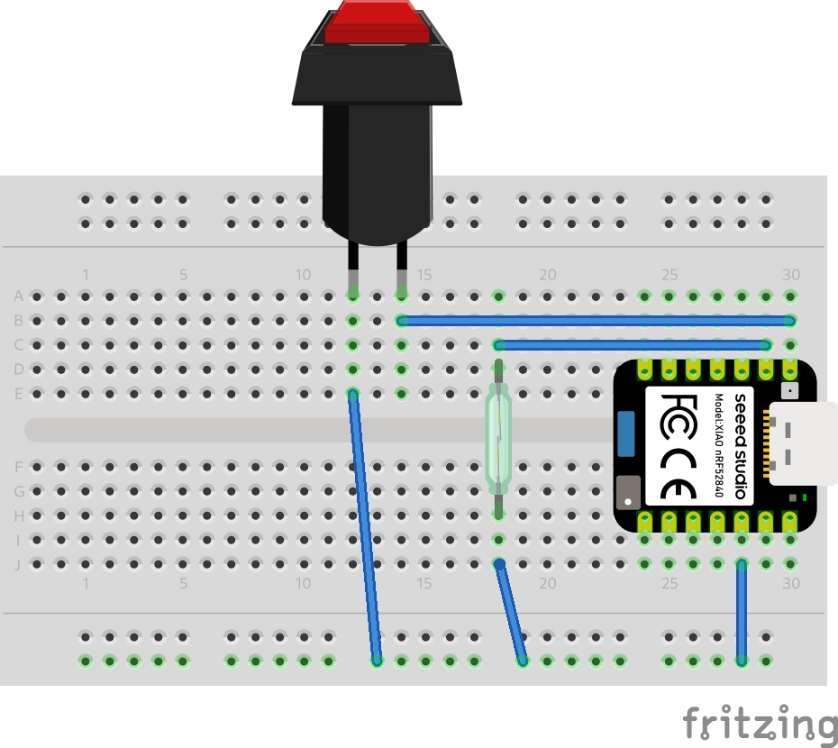

# Zigbee Gas Counter for nRF52840

Version 2.0 — a DIY, battery-powered Zigbee pulse counter for mechanical gas meters, built around the Nordic Semiconductor nRF52840.

A magnetic reed sensor detects the meter's pulses. The firmware maintains a cumulative counter locally and publishes gas consumption in cubic meters (m³) through Zigbee for use with Zigbee2MQTT and Home Assistant.

Counting does not depend on the coordinator, Zigbee2MQTT, or Home Assistant being online. In the deep-sleep configuration, the device wakes to process reed events and enables Zigbee when a report or user interaction is needed.

## Features

- Local pulse counting with a cumulative value saved in non-volatile memory.
- Gas consumption exposed through the Zigbee Metering cluster.
- System OFF operation with wake-up from the reed sensor or main button.
- Reed state retained across sleep cycles to distinguish pulse activation from release.
- Zigbee reporting after every 10 completed meter pulses in the normal deep-sleep configuration.
- Main button gestures for reporting, restarting, and leaving/rejoining the network.
- Battery voltage and estimated battery percentage reporting.
- Integrated XIAO battery measurement circuit; no external measurement divider is needed for this board.
- MCUboot bootloader and Zigbee OTA firmware updates.
- Firmware targets for the Seeed Studio XIAO nRF52840 and Nordic Semiconductor nRF52840 DK.
- Two-cell parallel 18650 holder, designed to maintain power from one cell during servicing, subject to the safety conditions below.
- 3D-printable enclosure and battery holder, with STEP files included.
- Compile-time options for gas flow, battery measurement, sleep behavior, and remote counter adjustment.

Power consumption and battery runtime have not yet been characterized sufficiently to publish measured figures. No particular current draw or battery life is guaranteed.

## Hardware Pictures

### Fully assembled device


### Cover removed


### Cover removed and bottom battery extracted


## Supported Boards

| Board | Intended use |
| --- | --- |
| Seeed Studio XIAO nRF52840 | The board used in the deployed battery-powered counter and custom enclosure. The wiring below applies to this target. |
| Nordic Semiconductor nRF52840 DK | Development, debugging, and testing, with convenient access to SWD, buttons, LEDs, and debug interfaces. |

Use the configuration and overlay for the selected board. The XIAO battery circuit and physical connections below must not be assumed to apply to the DK.

## Connection Diagram and Wiring

Version 2.0 simplifies the XIAO wiring by using its integrated battery measurement circuit.



[Download the editable Fritzing project (.fzz)](hardware/GasCounter.fzz)

The `.fzz` file is a Fritzing project, not an image. Open the link and use GitHub's raw-file download option, then open the downloaded file in Fritzing. The JPG above is the viewable wiring illustration.

### Main button and reed sensor: front-side connections

Both inputs are configured as `GPIO_PULL_DOWN | GPIO_ACTIVE_HIGH`. Each contact connects its input to the board's **3V3** output when closed. The pull-downs are internal; no external pull-down resistors are required by this configuration.

| Component | XIAO connection | Other terminal | Firmware name |
| --- | --- | --- | --- |
| Main push button, normally open | D0 / P0.02 | 3V3 | `main_button` |
| Gas meter reed contact | D1 / P0.03 | 3V3 | `reed_input` |

```text
                 Seeed Studio XIAO nRF52840
                 FRONT — logical wiring view
                 (not a physical pin-position map)

       +---------------- board 3V3 output ----------------+
       |                                                 |
       o                                                 o
      /  Main push button, normally open                 /  Reed contact
       o                                                 o
       |                                                 |
       +---- D0 / P0.02                    D1 / P0.03 ----+
             main_button                    reed_input
                  |                              |
           internal pull-down             internal pull-down
                  |                              |
                 GND                            GND

       Open contact = LOW; closed contact = HIGH (3.3 V)
```

D0 is the main button; D1 is the reed input. The application button is separate from the board's reset button. Use a dry reed contact: do not apply battery voltage, 5 V, or another meter's powered output directly to these GPIOs.

The [Seeed Studio board documentation](https://wiki.seeedstudio.com/XIAO_BLE/) provides the physical pinout. The project's [XIAO overlay](boards/gas_counter_xiao_nrf52840.overlay) defines the input assignments and pull-down configuration.

### Battery: rear-side pads

The battery is omitted from the breadboard illustration above. Connect the battery assembly to the **BAT+ and BAT− pads on the back of the XIAO**, checking the board markings before soldering.

| Battery assembly terminal | XIAO rear pad |
| --- | --- |
| Positive | BAT+ |
| Negative | BAT− / GND |

```text
       TWO 18650 CELLS IN PARALLEL — 1S2P
       Electrical topology only; protection is not shown.

       Cell A (+) ----+---- Cell B (+)
                     |
                     +---- pack positive ---- BAT+ rear pad

       Cell A (-) ----+---- Cell B (-)
                     |
                     +---- pack negative ---- BAT- rear pad / GND

       Same voltage as one cell; nominal capacities add.
       See Battery System and Safety before assembling or servicing.
```

**BAT+ and 3V3 are different connections.** BAT+ receives the battery supply; 3V3 is the regulated board output used by the button and reed contacts. Do not connect the battery directly to 3V3, D0, or D1. The diagram shows connectivity, not the physical order of the rear pads.

### Integrated battery measurement

The XIAO already includes the battery voltage measurement path:

| Signal | Role |
| --- | --- |
| P0.14 / `READ_BAT_ENABLE` | Active-low control for the onboard measurement divider. |
| P0.31 / AIN7 | ADC input that reads the divided battery voltage. |

These are internal board connections; no additional wires to these pins are needed. The firmware drives P0.14 LOW for measurement, waits for settling, reads P0.31, and applies the battery-voltage scaling. The current implementation uses a factor of three, then releases P0.14 to a high-impedance input. It does not drive P0.14 HIGH.

Seeed documents a potential ADC-input overvoltage issue when P0.14 is driven HIGH, particularly while charging. Follow the [manufacturer's battery measurement and charging guidance](https://wiki.seeedstudio.com/battery_charging_considerations/) when changing this behavior. Releasing the pin is the project's implementation, not a claim of manufacturer validation for every charging condition.

Battery percentage is an estimate derived from voltage, not a direct measurement of remaining capacity. Parallel cells share one pack voltage, so this measurement cannot assess each cell's health separately.

## How Counting and Deep Sleep Work

The meter's magnet closes and releases the reed contact. The firmware filters contact transitions and maintains the cumulative count locally. The volume represented by each completed pulse must match the meter's pulse specification and the firmware's conversion settings.

### System OFF: two wake-up inputs and two reed transitions

In deep-sleep mode, the nRF52840 enters **System OFF**. Application code does not continue running in this state. GPIO sensing wakes the device, and waking from System OFF performs a reset; the firmware restores state before processing the event. This behavior is described in the [nRF52840 power documentation](https://docs.nordicsemi.com/r/bundle/ps_nrf52840/page/power.html).

Both the main button and reed sensor can wake the device. The reed also uses an alternating sequence so a closed contact can be handled without repeatedly counting it:

```text
       Reed open / LOW
             |
             | magnet closes contact
             v
       Reed closed / HIGH  -> wake, remember WAIT_FOR_RELEASE
             |                arm wake-up for LOW
             | magnet moves away
             v
       Reed open / LOW     -> wake, count ONE completed pulse
                              remember WAIT_FOR_ACTIVATION
                              arm wake-up for HIGH
```

A complete pulse can therefore involve two System OFF wake-ups: one on closure and one on release. It produces **one counter increment**, on the accepted release transition. If the device is already awake, the transitions are handled without requiring a new boot. Waking to process a reed transition does not necessarily enable Zigbee.

### Persistence

Two storage mechanisms serve different purposes:

- **Non-volatile settings storage:** saves the cumulative counter, the optional counter adjustment, and the battery timing reference. Saved values are loaded at startup. The firmware schedules counter saves and blocks normal sleep entry while those writes are pending.
- **Retained RAM:** preserves operational state across supported reset and System OFF cycles, including the next expected reed level and the last reported summation. Retained state is checked before use. It is not a substitute for non-volatile storage after complete power removal.

An ordinary restart does not intentionally clear the gas counter. Abrupt power loss can still interrupt an unfinished write, and pulses occurring while the device is unpowered cannot be recorded. Erasing flash or changing the storage layout can remove saved values. Keep the physical meter as the authoritative reading.

The implementation is in [reed handling](src/zb_reed.c), [retained state](src/zb_retained.c), and [non-volatile storage](src/zb_nvr.c).

## Zigbee Operation and Integration

The device operates as an end device, not a router. In deep-sleep mode, Zigbee is normally inactive. The firmware enables it after every 10 completed meter pulses in the normal configuration, or when the main button requests access. Remote commands require the device to be awake and connected.

The reported cumulative value lets Zigbee2MQTT catch up after a network outage; counting continues locally while the device remains powered. The Home Assistant display can therefore lag behind the physical meter between reports.

| Identifier | Value |
| --- | --- |
| Manufacturer name | `Custom devices (DiY)` |
| Model identifier | `MiCASAGasCounter` |
| Manufacturer code | `0x8888` |

The manufacturer code is an arbitrary value used by this DIY project. Standard Zigbee attributes are used where possible; remote counter adjustment uses a manufacturer-specific attribute in the Metering cluster.

Use Zigbee2MQTT with a converter that supports the features enabled in the firmware. Home Assistant is optional and consumes the data through Zigbee2MQTT. See the [Zigbee2MQTT device page](https://www.zigbee2mqtt.io/devices/MiCASAGasCounter.html) for the integration's exposed controls.

### Time and battery update interval

The nRF52840 has RTC peripherals, but they do not provide a running wall clock through System OFF. This firmware uses time obtained through Zigbee to evaluate the age of its saved battery measurement reference.

The configured battery refresh threshold is **12 hours**. This is evaluated when the device is awake and has the required timing information; it does not mean a timer wakes the device from System OFF every 12 hours. With no reed or button activity, or with the network unavailable, the reported battery value can remain older. A single button click forces a fresh measurement when battery measurement is enabled.

## Main Button Gestures

| Gesture | Action |
| --- | --- |
| Any press, including the start of another gesture | Enables Zigbee and opens an approximately one-minute user access window in deep-sleep mode. |
| Single click | Requests counter and status reports, forces battery measurement when enabled, and clears status flags for subsequent reevaluation. |
| Triple click | Restarts the device without intentionally clearing the saved gas counter. |
| Five quick clicks | Leaves the current Zigbee network and starts joining again. |

Allow approximately 10 seconds for connectivity to recover after pressing the button; actual reconnection time depends on the network. Use the access window before requesting reports, changing the counter value, or starting OTA.

### Setting the counter value

With `FEATURE_WRITE_COUNTER_VALUE` enabled in [include/zb_features.h](include/zb_features.h), a manufacturer-specific Metering attribute allows the reported total to be aligned with the physical meter reading.

1. Read the physical meter and check the units expected by the Zigbee2MQTT control.
2. Press the main button and wait for the device to reconnect.
3. Write the required value through the supported Zigbee2MQTT control.
4. Check the next reported total against the intended reading.

The firmware persists the adjustment. This feature does not make the standard read-only summation attribute writable. If the feature is disabled, remote counter adjustment is unavailable.

## Battery System and Safety

The prototype uses two rechargeable 3400 mAh 18650 lithium-ion cells **in parallel (1S2P)**. Their combined nominal capacity is approximately 6800 mAh; pack voltage remains that of a single cell. Nominal capacity alone does not establish usable runtime.

The holder permits one cell to remain connected while the other is removed. Maintaining power can avoid a counting interruption, but **a removable holder is not a protected hot-swap circuit**.

- Use matched cells of the same chemistry, model, capacity, and similar age and condition, approved for the intended assembly. Do not mix damaged cells or cells with damaged insulation.
- Never connect the two cells in series. Check polarity and holder wiring before connecting the XIAO.
- Do not directly parallel cells at different states of charge. A voltage difference can cause a large equalization current between cells, bypassing the board's charger.
- In particular, do not insert a freshly charged cell alongside a substantially discharged cell. Continuous-power replacement requires a battery system designed to control insertion current and prevent unsafe cross-charging. Otherwise, power down and service the matched pair together using the cell manufacturer's procedure, accepting the counting interruption.
- Use suitable overcharge, over-discharge, overcurrent, and short-circuit protection, with appropriate fusing and insulated contacts. Do not assume the XIAO charging circuit or a plain holder supplies all pack protection.
- Charge removed cells only with a suitable lithium-ion charger. Before using USB charging with the assembled pack, verify compatibility with the exact board revision, cell specifications, protection circuit, and the P0.14/P0.31 measurement behavior described above.
- If servicing with a suitably protected continuous-power system, keep at least one healthy cell connected and avoid disturbing its contacts. Persistence cannot recover pulses missed during a power interruption.

Lithium-ion cells require a properly designed battery assembly; follow the cell manufacturer's handling requirements. See [Samsung SDI's battery safety information](https://www.samsungsdi.com/business/isi.html) for manufacturer guidance on cells and protective battery packs.

### Power consumption and runtime

Deep sleep is intended to reduce active time and radio use. Actual consumption depends on the board, firmware, pulse rate, reed closure duration, network conditions, reporting, OTA activity, and battery circuit.

Long-term battery life is still being measured. This README makes no claim of measured sleep current, average current, or a specific runtime. The two nominal cell capacities must not be interpreted as proof of months or years of operation.

## Required Hardware

- Seeed Studio XIAO nRF52840 for the deployed version.
- Magnetic reed sensor suitable for the meter's pulse mechanism.
- Normally open main push button.
- Two matched rechargeable 18650 cells and a suitable protected battery assembly.
- Battery contacts or holder hardware, insulated wiring, and appropriate protection.
- 3D-printed enclosure and battery holder.
- 18 small magnets, 4.75 mm × 1.5 mm; see the [hardware folder](hardware).
- SWD programmer/debugger for initial programming.

The nRF52840 DK can be used instead for development with its own wiring and configuration. Install the sensor without opening or modifying the gas meter or disturbing seals. This DIY counter is for consumption monitoring, not gas leak detection or certified billing.

## Software Requirements

- nRF Connect SDK with the Zigbee support required by the project.
- Zephyr RTOS and MCUboot from the project's compatible SDK environment.
- SWD flashing/debugging tools.
- A Zigbee coordinator and Zigbee2MQTT.
- Home Assistant, optionally.

## Configuration Options

Review [include/zb_features.h](include/zb_features.h) before building. These are compile-time options; changing them requires rebuilding and flashing the firmware.

| Option | Default | Purpose |
| --- | --- | --- |
| `FEATURE_MEASURE_FLOW_RATE` | Disabled | Enables optional gas flow measurement. More frequent timing and communication can increase energy use. |
| `FEATURE_MEASURE_BATTERY_LEVEL` | Enabled | Enables battery voltage measurement and estimated percentage reporting. Disable for deployments that do not need it. |
| `FEATURE_DEEP_SLEEP` | Enabled | Enables the System OFF operating model described above, with event-driven wake-up and intermittent Zigbee access. |
| `FEATURE_LIGHT_SLEEP` | Disabled | Selects the alternative mode that avoids System OFF for more conventional network availability. |
| `FEATURE_WRITE_COUNTER_VALUE` | Enabled | Enables the manufacturer-specific counter adjustment attribute. |

Define at most one sleep option. Both may be left undefined for an application that does not use the deep-sleep policy. Light-sleep and continuously awake configurations should be validated on the intended target; they do not inherit the System OFF behavior described here. Keeping the Zigbee stack available does not mean the radio transmits continuously.

The deployed configuration uses deep sleep. Gas flow measurement and alternative sleep settings are options, rather than a claim that every combination has been tested on the deployed hardware. For externally powered development, availability may be more useful than minimizing active time.

Meter-specific pulse scaling and board wiring must also match the installation. Do not infer a pulse volume solely from the meter's appearance.

## Building and Initial Flashing

The project uses nRF Connect SDK, Zephyr, and MCUboot. Select the intended board and its matching configuration and overlay; the XIAO target uses the custom board definition supplied in this repository.

1. Open the project in a compatible nRF Connect SDK environment.
2. Review the board configuration and `include/zb_features.h`.
3. Build with MCUboot enabled using the repository's sysbuild configuration.
4. Connect an SWD programmer/debugger and flash the complete generated **`merged.hex`** image, including MCUboot and the application. Flashing only the application is insufficient for initial MCUboot installation.
5. Enable joining on the coordinator and pair the device.
6. Verify reed counting, button actions, battery readings, and Zigbee reports before installing the enclosure. Set the initial meter reading if the write feature is enabled.

Use the board identifier and output location from the selected SDK/build configuration. This README does not prescribe an unverified SDK version or a universal build command.

## Zigbee OTA Firmware Updates

After MCUboot and the initial application have been installed through SWD, compatible future firmware can be delivered through Zigbee OTA.

1. Build a compatible OTA image for the same target and bootloader configuration, and make it available to Zigbee2MQTT's OTA service.
2. Press the main button to make the device reachable.
3. Wait approximately 10 seconds and confirm that Zigbee connectivity has recovered.
4. Start the OTA update from Zigbee2MQTT and keep power stable during transfer and reboot.
5. Check that the device reconnects and reports after the update.

The firmware keeps the device awake during an active OTA operation. After download, it reboots and MCUboot performs the image update. The application confirms the new image after startup and Zigbee recovery, reducing the risk of confirming firmware that starts but cannot restore basic connectivity.

OTA compatibility depends on the image, bootloader, and partition layout. Do not treat OTA as a substitute for SWD recovery or assume a flash erase will preserve the counter.

## 3D-Printed Hardware

The [hardware folder](hardware) contains STEP files for the enclosure and battery holder. The assembly accommodates the XIAO board, two 18650 cells, main button, reed sensor, and removable cover.

The mechanical design allows access to individual cells, but safe continuous-power servicing depends on the electrical battery assembly described above. Secure and insulate wiring so removing the cover or a cell cannot short the battery contacts.

## Project Status and Background

This project is the nRF52840 evolution of the earlier ESP32-C6 Zigbee gas counter. That version established the concept; this version focuses on reducing active time, improving OTA handling, and maintaining local counting independently of the home automation system.

The project reports working pulse counting, Zigbee integration, battery reporting, main button gestures, and Zigbee OTA. MCUboot image confirmation is handled by the application after startup and network recovery. Long-term runtime testing remains in progress.

## Customization

The same approach can be adapted to water meters, electricity meters with suitable pulse outputs, or other mechanical counters. Adapt the measurement units, pulse conversion, input interface, and Zigbee attributes. A powered pulse output may need level shifting or isolation; the dry-contact wiring shown here is specific to this reed-based installation.

## Contributing

Contributions, suggestions, and improvements are welcome, particularly for:

- Power measurements and repeatable runtime testing.
- Zigbee2MQTT converter support.
- Hardware and battery protection review.
- Testing alternative reed sensors and enclosure variants.
- Documentation and validation of additional configurations.

When reporting results, include the board, firmware configuration, power source, and test conditions so measurements can be reproduced.

## Acknowledgments

Thanks to Nordic Semiconductor for its online training and documentation, which helped accelerate development on the nRF52840 platform.

ChatGPT also helped during development with debugging, exploring solutions, and preparing documentation.

## License

This project is shared under the **Creative Commons Attribution-NonCommercial-ShareAlike 4.0 International License (CC BY-NC-SA 4.0)**.

You may copy, modify, and adapt the project for personal or non-commercial use, provided that you give appropriate credit and share derived work under the same license. Commercial use is not allowed under this license.

See [LICENSE.txt](LICENSE.txt) and the [Creative Commons Attribution-NonCommercial-ShareAlike 4.0 International license](https://creativecommons.org/licenses/by-nc-sa/4.0/deed.en) for the full terms.
